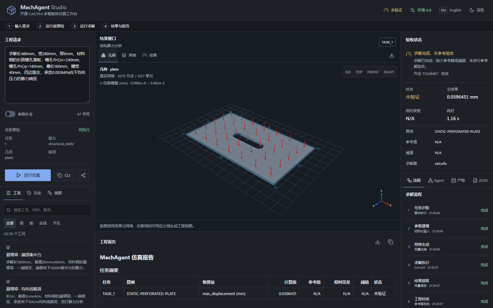
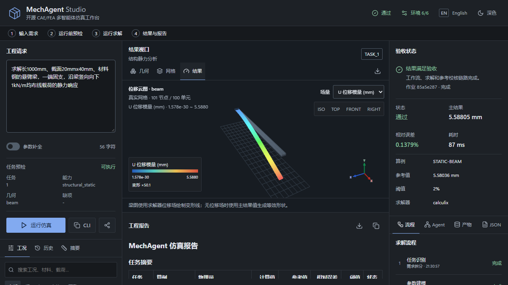

# MechAgent

MechAgent 是开源 CAE/FEA 多智能体编排框架，提供本地 Studio、CLI 和 Python SDK，将自然语言工程请求组织为参数建模、网格、求解、后处理、校核与报告。

框架通过能力注册、工具注册和 Pydantic 数据契约连接工程任务与外部工具。求解器和网格器属于可替换后端，专用求解格式和编译逻辑由适配器管理。内置执行能力为结构线弹性静力，使用 CalculiX 与 Gmsh；具体输入范围见[能力与自然语言解析](docs/capabilities.md)。

## Studio

Studio 采用工程工作台布局：左侧输入与工况库，中间几何、网格和结果视口，右侧验收与执行证据，下方工程报告。界面支持中英文、深色、浅色与跟随系统主题。语言切换保留工程请求、报告和工具诊断的来源语言。





## 安装与启动

需要 Python 3.10 及以上版本。以下 `python` 指向已激活的独立虚拟环境；本机维护环境使用 `D:/anaconda3/envs/AGENT/python.exe`。

```powershell
py -3.10 -m venv .venv
.\.venv\Scripts\Activate.ps1
python -m pip install -e packages/mechagent-core
python -m pip install -e "packages/mechagent[dev,docs]"
```

将 `.env.example` 复制为本地 `.env`，按需设置 `CALCULIX_CCX`。LLM 通过 `URL`、`API_KEY`、`MODEL_NAME` 配置，默认不参与执行；确定性解析可用时，无须 LLM 凭证。

```powershell
python -m mechagent.cli doctor
python -m mechagent.cli studio --open-browser
python -m mechagent.cli demo
python -m mechagent.cli examples
python -m mechagent.cli inspect "求解长1000mm、截面20mmx40mm、材料钢的悬臂梁，一端固支，端部向下1000N集中力的静力响应" --json
python -m mechagent.cli run "求解长1000mm、截面20mmx40mm、材料钢的悬臂梁，一端固支，端部向下1000N集中力的静力响应"
```

Studio 默认地址为 `http://127.0.0.1:8765`。启用参数补全和工程解释可使用 `--llm-agents`。安装、配置优先级、前端开发和故障排查见[本地开发配置](docs/local_setup.md)。

Studio 的稳定 HTTP 客户端边界为 `/api/v1`；旧 `/api` 路径只用于兼容已有本地集成，并带有弃用与 Sunset 响应头。服务支持配置一个 Bearer API key 主体、角色和项目范围；队列模型是本机 SQLite，多节点高可用属于部署扩展。

## 执行与可信边界

- 生产入口接收工程请求；TC-01 至 TC-05 用于独立验证，生产任务仍按能力契约解析。
- 内置模型族包括悬臂梁、四边简支矩形薄板、圆孔/多孔/长圆槽孔薄板和矩形实体块。材料执行路径为各向同性线弹性。
- CAD 导入生成版本化 `CADArtifact`、`GeometryValidation`、`RegionBinding`、源摘要、可追踪拓扑实体和区域候选；校验通过且 `execution_ready=true` 时，`gmsh-cad-inp` 才能直接生成 C3D4 网格、节点集合并交给 CalculiX。拓扑 ID 只在同一导入摘要中可复用。当前直接 CAD 证据覆盖确定性实体和带贯穿圆孔实体；装配体、薄板和复杂 CAD 需要独立的几何、区域和网格证据。
- 几何建模闭环、CAD 清理边界和直接 CAD 网格的限制见[几何建模与网格边界](docs/geometry_ai.md)。自然语言生成 CAD 只能产生候选，必须经过几何回读、区域绑定、网格质量和求解验证。
- `success` 表示执行成功；`verification_status=passed` 表示参考验收通过。缺少参考值或阈值时为 `unverified`，工程验收需要相应参考证据或验证规则。
- Studio 使用本机持久队列与独立 worker，支持取消、幂等提交、并发限制、项目级活动作业配额、结果大小上限、重启查询和显式重试。终态作业的结果、报告、输入、网格和求解输出按安全相对路径登记到内容寻址对象存储，也可配置 S3 兼容对象存储；SDK/CLI/Studio 保存带 `mechagent.evidence-provenance.v1` 的运行证据清单，文件完整性、来源一致性与工程验收分别判断。
- 求解器结果同时记录案例摘要、输入文件 SHA-256 以及工作目录内输入/输出文件的相对路径、大小和 SHA-256；这些记录用于运行证据、备份和跨后端结果定位，不替代参考解或工程验收。
- 复合请求按任务目录隔离，任务失败保留阶段产物和错误，其余任务继续执行。公开摘要字段不含原始 LLM prompt、response 或密钥。
- Abaqus/Standard 适配器已注册到求解器工厂，支持结构静力输入、ODB 场量提取、多分析步输入生成以及可选许可证探针和本地并发槽位；跨工具比较器支持同节点、坐标对应、一维梁网格中心线映射、原始单元场的质心坐标配对和统一单元质心字段。TC-01、TC-03、TC-04 已在本机使用同一 `SimulationCase` 完成请求位移、统一单元质心字段和统一语义摘要比较；权威证据为 `mechagent_output/backend-comparison-current/manifest.json`。位移和统一语义摘要阈值为相对误差 3% 或绝对误差 0.005 mm，统一单元质心字段阈值为相对误差 10% 或绝对误差 0.005。原始 `element` 位置的 `volume` 字段在完整单元质心坐标下完成配对；积分点应力、逐节点反力、梁截面展开场和原始能量场仍未建立跨网格的一一映射；许可证服务人工审计以及非线性、接触、损伤、动力学和多物理场属于后续能力门禁。

## 验证与贡献

```powershell
python scripts/check_env.py --profile portable
python -m pytest -m "not real_solver"
python scripts/run_benchmarks.py
python scripts/run_natural_language_cases.py
```

质量门禁、LLM smoke、包安装检查和证据解释以[验证与质量门禁](docs/validation.md)为准。贡献流程见[贡献指南](CONTRIBUTING.md)，文档入口见[文档目录](docs/index.md)。

## 代码与文档

| 位置 | 职责 |
| --- | --- |
| `packages/mechagent-core` | 数据模型、材料目录、CAD、网格、求解、执行器、后处理与验证参考 |
| `packages/mechagent` | SDK、CLI、Studio 服务、编排、LLM 与知识层 |
| `apps/mechagent-studio` | React/TypeScript 工作台与 Three.js 视口 |
| `knowledge/sources` | 可随仓库发布的公开知识源 |
| `scripts` / `tests` | 环境检查、验证、构建、清理与自动化测试；脚本职责见[脚本职责目录](docs/script_catalog.md) |
| [架构](docs/architecture.md) | 模块依赖、注册 API、数据与状态契约 |
| [产品蓝图](docs/product_blueprint.md) | 用户任务、交互入口和产品边界 |
| [长周期开发计划书](docs/development_plan.md) | 能力成熟度、工具接入、依赖顺序和发布条件 |
| [技术报告](docs/technical_report.md) | 当前架构、执行契约、验证证据和发布条件汇总 |
| [几何路线](docs/geometry_ai.md) | CAD 导入、几何候选验证、网格可信边界和开源项目调研 |

项目采用 Apache License 2.0。外部求解器与 CAD 软件的安装和许可由其各自条款管理。
