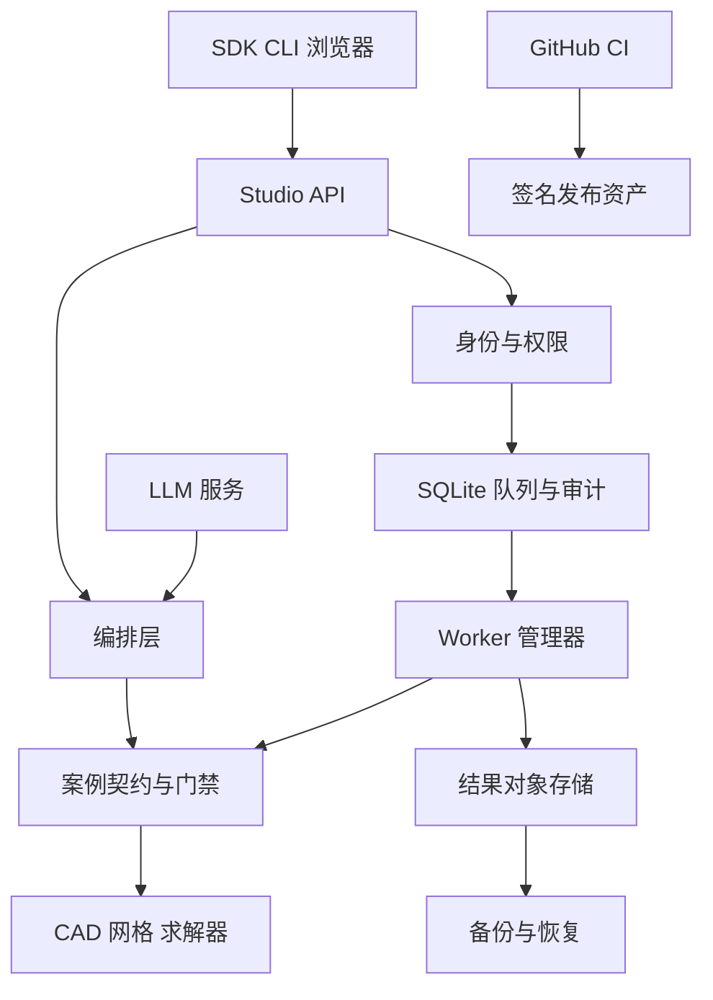

# MechAgent 安全风险与防护边界

威胁模型是对“谁可能以什么方式影响系统、会造成什么后果、已有哪项防护、还缺什么门禁”的结构化说明。本页面向项目维护者和部署者，帮助他们在本机或受控内网部署 MechAgent 时识别风险；它不表示系统已经通过渗透测试，也不表示求解结果具有物理正确性。

## 执行摘要

MechAgent 是本机优先的 CAE/FEA 工作平台：HTTP Studio、SDK 和 CLI 接收工程请求，经过 Pydantic 案例契约和能力门禁后，将任务写入 SQLite 队列，由独立 worker 调用 CAD、网格器和求解器，并把结果写入本地或 S3 对象存储。最高风险集中在求解器进程边界、主体与项目授权、工程文件和备份对象的保密性、资源耗尽，以及未签名构建产物被替换；当前实现已覆盖输入 schema、API key 摘要、组织/项目范围、路径和进程约束、对象摘要校验、审计与备份校验，但外部身份、跨主机隔离、S3 部署策略和可信签名仍需部署级证据。

## 范围与运行假设

- **代码范围**：`packages/mechagent/src/mechagent/ui/`、`packages/mechagent/src/mechagent/runtime/`、`packages/mechagent/src/mechagent/orchestrator/`、`packages/mechagent-core/src/mechagent/core/`、`scripts/`、`.github/workflows/` 及其直接配置和测试。
- **运行方式**：Studio 默认绑定 `127.0.0.1:8765`；SDK 和 CLI 可以绕过 Studio 直接运行。Studio 使用单个 SQLite 数据库和本地 worker；结果对象可以写入本地目录或 S3 兼容存储。
- **部署假设**：部署在本机或受控内网，认证使用本地 API key，数据包括工程文件、仿真输入、结果和诊断，按内部工程数据保护。若改为互联网暴露、外部身份提供商或多组织生产部署，必须重新评估风险等级。
- **维护者控制的输入**：求解器路径、配置文件、S3 endpoint、队列容量、许可证探针、备份目标和 CI 发布凭据。
- **请求方可控制的输入**：HTTP 请求、`Idempotency-Key`、请求正文、案例参数、结果字段、可见文件路径、CAD/网格/求解器输入及 LLM 返回内容。
- **范围外**：Abaqus、CalculiX、Gmsh、Python、Node、SQLite、S3 服务本身的供应商实现缺陷；这些组件的配置、调用方式和输出处理仍在范围内。

需要在部署变化时重新评估的事项包括：是否开放互联网访问、是否改用 OIDC、是否由多个组织共享一个实例，以及工程数据是否受出口管制或其他法规约束。

## 系统组成与数据流

### 主要组件

- **Studio API**：`packages/mechagent/src/mechagent/ui/server.py` 提供健康检查、诊断、能力、案例、作业、主体、审计、指标、证据和同步运行接口。
- **运行存储和 worker**：`packages/mechagent/src/mechagent/runtime/store.py`、`worker.py`、`manager.py` 管理 SQLite 状态机、幂等键、权限范围、审计、配额和独立进程。
- **Core contracts and adapters**：`packages/mechagent-core/src/mechagent/core/models/` 定义案例契约；`core/factory.py` 注册求解器、网格器和执行器；Abaqus、CalculiX、Gmsh 适配器负责外部工具边界。
- **编排层和 LLM**：`packages/mechagent/src/mechagent/orchestrator/` 解析请求、生成候选参数和工程解释；结构化输出仍须经过能力注册、Pydantic 和执行门禁。
- **结果对象和备份存储**：`packages/mechagent/src/mechagent/runtime/artifacts.py`、`backup.py` 提供内容寻址对象、本地/S3 写入、摘要校验、备份和恢复。
- **构建和发布**：`.github/workflows/pr.yml` 和 `.github/workflows/release.yml` 构建 wheel、Studio、SBOM、发布清单、provenance，并在显式 tag 上执行 OIDC 签名流程。

### 数据流和边界

- **客户端 → Studio API**：HTTP/JSON 传输请求、Bearer API key、幂等键和组织/项目字段；`server.py` 解析请求，`runtime/auth.py` 检查主体、角色、组织和项目范围。默认回环监听不提供传输加密；外部部署的 TLS、反向代理和速率限制由部署环境负责。
- **Studio API → SQLite 队列**：事务写入请求、配置路径、源文件摘要、主体、组织、项目和审计事件；`runtime/store.py` 使用 `BEGIN IMMEDIATE`、schema 迁移和状态约束，数据库文件及 WAL 必须由操作者保护。
- **队列 → worker 进程**：本地进程边界传递作业 ID、配置和受控命令；`runtime/worker.py` 与 `core/executor.py` 校验 PID/创建时间、超时、取消和子进程树。Windows Job Object 已覆盖本机后代进程，POSIX 孤儿回收仍未完成跨平台验收。
- **worker → CAD/网格/求解器**：文件和命令参数跨进程边界传递；工厂和适配器生成输入，`LocalCommandExecutor` 使用参数数组启动工具。外部工具输出按不可信诊断和场量处理，工具本身不属于 MechAgent 的信任域。
- **worker → 结果对象存储**：结果、运行清单和 SHA-256 记录写入本地对象或 S3；`runtime/artifacts.py` 做内容寻址和写入后校验。S3 凭据来自 boto3 标准链，桶权限、TLS、生命周期和跨主机恢复尚未由仓库证据证明。
- **API → 客户端**：公开摘要、状态、证据和报告通过 JSON 返回；`redaction.py` 和指标接口移除凭据、请求正文、路径和原始 worker 诊断。完整结果仅通过授权的单作业查询返回。
- **CI → 发布资产**：GitHub Actions 使用 tag、构建环境、OIDC 和 cosign 产生包、SBOM、清单和签名 bundle；本地清单只证明内容摘要，不证明发布者身份。

#### 关系图

## 重要资产和保护目标

| 资产 | 重要性 | 保护目标（保密性/完整性/可用性） |
| --- | --- | --- |
| API key 和 S3 凭据 | 可提交作业、读取结果或删除对象 | C/I |
| 工程请求、CAD、网格、输入文件和结果场 | 可能包含专有设计和可复现的工程结论 | C/I |
| SQLite 作业、身份、项目和审计记录 | 决定授权边界、状态和可追责性 | I/A |
| Worker 与求解器资源 | 可消耗 CPU、内存、磁盘和许可证 | A |
| 运行 manifest、SHA-256 和报告 | 支撑结果复核和发布追溯 | I |
| 备份、WAL 和对象存储 | 影响恢复能力并集中保存工程数据 | C/I/A |
| wheel、sdist、Studio 静态资产和 SBOM | 客户端执行代码和供应链证据 | I |
| LLM prompt、trace 和结构化候选 | 可能包含工程数据并影响工具选择 | C/I |

## 风险主体与能力

### 可实施的行为

- 能向暴露的 HTTP/CLI/SDK 入口提交恶意或超大请求、伪造案例字段、重复作业和异常文件路径。
- 能使用泄露的低权限 API key 读取其范围内的作业，尝试跨组织、跨项目或管理员接口。
- 在受控内网假设下，可能读取错误日志、备份目录、对象存储或构建产物；若服务被互联网暴露，能力扩大为远程未授权探测和资源耗尽。
- 能构造恶意 CAD、网格、JSON、YAML、求解器输出或 LLM 响应，诱发解析、资源或完整性问题。

### 不纳入当前假设的能力

- 不假设攻击者可直接修改主机内核、Abaqus/CalculiX/Gmsh 安装目录或 GitHub 组织设置。
- 不假设攻击者拥有有效的 GitHub OIDC 发布身份、S3 管理员权限或数据库主机管理员权限；获得这些权限后应按更高等级重新建模。
- 不把求解器内部数值错误视为安全漏洞，除非它导致越权、任意代码执行、数据泄露或资源失控。

## 入口和风险面

| 入口 | 访问方式 | 所在边界 | 说明 | 代码依据 |
| --- | --- | --- | --- | --- |
| API v1 和兼容 API | HTTP 请求 | 客户端 → API | 认证、授权、幂等、错误和结果过滤 | `packages/mechagent/src/mechagent/ui/server.py` 路由处理器 |
| 主体管理 | Bearer API key | API → 主体存储 | 创建、停用、轮换和范围更新均为管理员操作 | `runtime/auth.py`、`server.py` 主体路由 |
| 作业提交和重试 | JSON 正文和请求头 | API → 队列 | 请求可触发外部工具和资源消耗 | `server.py`、`runtime/store.py` |
| 证据和结果对象读取 | 作业 ID 和对象引用 | API → 对象存储 | 清单校验不等于数字签名 | `runtime/artifacts.py`、`evidence.py` |
| CAD/网格/求解器输入 | CLI 路径和生成文件 | worker → 外部工具 | 文件格式和工具诊断属于不可信输入 | `core/adapters/`、`core/executor.py` |
| LLM 服务 | HTTP 客户端和 prompt | 编排层 → 服务提供方 | 远端响应只允许进入结构化门禁 | `orchestrator/llm_structured.py`、`llm/backends.py` |
| 备份和恢复 | 运维 CLI 和 S3 | 运维者 → 备份目标 | 备份集中保存数据库和工程对象 | `scripts/backup_studio.py`、`runtime/backup.py` |
| 发布流程 | Git tag 和 CI 凭据 | GitHub → 发布资产 | 需要 OIDC、attestation 和签名验证 | `.github/workflows/release.yml`、`scripts/sign_release.py` |

## 主要滥用路径

1. 攻击者获得低权限 API key → 构造跨项目查询 → 利用过滤遗漏读取其他组织的作业或结果。
2. 攻击者提交超大或高耗时案例 → 触发重复网格和求解 → 占满 worker、磁盘或许可证，造成服务拒绝。
3. 攻击者提交恶意文件路径或 CAD/求解器输入 → 诱发路径穿越、工具命令注入或解析器资源耗尽 → 读取或覆盖本机文件。
4. 攻击者读取备份目录或 S3 前缀 → 获取数据库、对象和审计记录 → 暴露工程设计及身份元数据。
5. 攻击者篡改对象或结果清单 → 客户端读取被替换的结果 → 破坏工程结论的完整性和可追溯性。
6. 恶意 LLM 响应或 prompt 注入 → 生成越界工具参数或泄露工程上下文 → 触发未授权求解或数据外传。
7. 失陷的构建凭据或依赖 → 修改 wheel、静态资产或 SBOM → 发布带恶意代码的未可信版本。
8. 攻击者反复调用身份轮换、诊断或指标接口 → 放大数据库写入和日志量 → 降低服务可用性并污染审计。

## 风险清单

| 编号 | 风险来源 | 前置条件 | 行为 | 后果 | 受影响资产 | 已有防护（代码依据） | 剩余缺口 | 建议措施 | 发现方式 | 可能性 | 影响程度 | 优先级 |
| --- | --- | --- | --- | --- | --- | --- | --- | --- | --- | --- | --- | --- |
| TM-001 | 本地或远程 API 使用者 | 获得任意有效 key 或利用外部暴露 | 越权访问组织、项目、主体或审计接口 | 跨项目工程数据泄露、权限提升 | API key、项目、结果 | `runtime/auth.py` 角色/组织/项目检查；Studio 测试覆盖越权 | 无外部 IdP、无集中策略和跨服务审计 | 生产部署接入 OIDC；统一授权中间件；默认拒绝组织和项目过滤；对管理员操作强制二次认证 | 记录拒绝原因、主体、组织、项目、来源 IP；对跨范围探测告警 | 中 | 高 | 高 |
| TM-002 | 未受信任的作业提交者 | 可提交请求，或拥有 runner 权限 | 提交超大网格、重复任务或长时间求解耗尽资源 | worker、磁盘、许可证和 API 不可用 | 计算资源、存储、许可证 | 活动作业配额、超时、结果大小和本机磁盘配额；队列状态机 | S3 远端容量、跨主机配额和全局速率限制未验证 | 增加按主体/项目/组织的速率和并发预算；为 CAD、网格和求解设置独立 CPU/内存/磁盘配额；部署级 S3 配额 | 队列等待、拒绝率、CPU/内存、对象增长和许可证占用告警 | 高 | 高 | 高 |
| TM-003 | 恶意文件或案例输入 | 攻击者可控制路径、CAD 或生成的输入 | 利用路径穿越、命令参数、压缩/解析资源或求解器脚本执行代码 | 主机文件泄露、任意代码执行或 worker 失陷 | 主机文件、worker、凭据 | 参数数组执行、`safe_file_stem`、输入契约、路径边界和 Job Object | 求解器和 CAD 解析器不在容器或低权限沙箱；跨平台孤儿回收未验收 | 将 worker 放入低权限隔离环境；仅允许内容寻址输入；拒绝符号链接和仓库外路径；限制文件大小、压缩比和解析时间；分离工具账户 | 记录规范化路径、工具命令摘要、失败代码和隔离事件；检测异常子进程 | 中 | 严重 | 高 |
| TM-004 | 备份或存储读取者 | 能读备份目录、S3 前缀或错误日志 | 下载数据库、对象、WAL、prompt 和工程结果 | 工程数据和 API 元数据泄露 | 备份、结果对象、审计数据 | 结果 API 脱敏；备份清单和对象 SHA-256 校验；凭据不写入清单 | S3 IAM、加密、生命周期、跨主机恢复和备份访问审计未验收 | 使用最小 S3 IAM、服务端加密和独立备份账户；备份加密并设置保留/删除策略；禁止公开日志目录 | 监控对象列举、下载、删除和备份读取；定期恢复并核对访问日志 | 中 | 高 | 高 |
| TM-005 | 存储或主机篡改者 | 可修改对象或本地结果目录 | 替换结果、manifest 或报告后诱导用户采信 | 工程结论不可追溯，可能造成错误决策 | 结果、证据、报告 | 内容寻址、SHA-256、manifest 校验和结果引用保护 | SHA-256 manifest 没有作者身份；未生成可信签名 bundle | 发布和外部共享前强制 cosign/OIDC 签名；客户端校验签名主体、issuer、commit 和 artifact digest；对象存储启用版本和锁定策略 | 监控 digest 变化、manifest 不匹配和签名主体变化 | 中 | 高 | 高 |
| TM-006 | Prompt 或服务提供方攻击者 | LLM 请求包含工程上下文，或 provider 返回恶意内容 | 诱导工具选择越权、泄露 prompt 或绕过数值门禁 | 数据外传、错误工具调用或错误结论 | Prompt、案例、求解动作 | 结构化输出、Pydantic/能力门禁、trace 脱敏和 LLM 失败不阻断主路径 | 外部 provider 的保留、训练和网络策略未由仓库控制；未有独立 prompt 数据分级 | 默认关闭远端 LLM；按字段脱敏和最小上下文；provider 合同禁止训练/保留；把工具调用设为显式 allowlist 并审计 | 记录 provider、模型、字段摘要和门禁拒绝原因；检测工具参数漂移 | 中 | 高 | 高 |
| TM-007 | 依赖或 CI 环节失陷者 | 能修改依赖源、构建环境或 tag 流程 | 替换 wheel、Studio 资产、SBOM 或发布清单 | 下游执行任意代码、供应链失信 | 发布资产、客户端 | 锁文件、SBOM、tag 版本检查、GitHub OIDC workflow 和 provenance 步骤 | 本地没有可信签名资产；发布前未由独立环境验证 attestation | 固定 action SHA；启用环境保护和最小 token；独立验证 attestation、签名身份和 SBOM；保留可回滚资产 | 监控 workflow 权限、依赖变更、签名主体和 digest 漂移 | 低 | 严重 | 高 |
| TM-008 | API 滥用者 | 能反复访问诊断、指标、轮换或查询接口 | 放大数据库写入、日志量或列表查询 | API 和审计服务降级 | SQLite、API、审计日志 | 认证、分页上限、事件上限、状态约束和幂等键 | 未有部署级速率限制、WAF 或集中日志限额 | 增加按 key/IP/组织的限流、查询成本限制和日志采样；身份轮换加入冷却窗口 | 监控 401/403/429、分页深度、轮换次数和审计写入延迟 | 中 | 中 | 中 |

## 严重程度定义

- **严重**：可在无额外主机权限下获得任意代码执行、跨组织工程数据，或替换可信发布资产。例如 TM-003 的 worker 逃逸、TM-007 的恶意发行包。
- **高**：需要有效主体或部署错误，但可造成跨项目数据泄露、持续资源拒绝、备份泄露或工程结果完整性破坏。例如 TM-001、TM-002、TM-004、TM-005、TM-006。
- **中**：影响单个主体或有限资源，不能绕过核心授权或执行任意代码。例如 TM-008 的受限查询放大。
- **低**：仅暴露低敏感状态、需要不现实的前置条件，且不影响工程数据、执行完整性或服务可用性。

## 建议重点检查的代码

| 路径 | 检查原因 | 相关编号 |
| --- | --- | --- |
| `packages/mechagent/src/mechagent/ui/server.py` | 所有 HTTP 路由、认证入口、结果过滤和兼容 API | TM-001, TM-002, TM-008 |
| `packages/mechagent/src/mechagent/runtime/auth.py` | API key 摘要、角色、组织和项目范围 | TM-001, TM-004 |
| `packages/mechagent/src/mechagent/runtime/store.py` | SQLite 状态、幂等、审计、配额和迁移 | TM-001, TM-002, TM-008 |
| `packages/mechagent/src/mechagent/runtime/worker.py` | worker 身份、环境、结果提交和进程边界 | TM-002, TM-003 |
| `packages/mechagent-core/src/mechagent/core/executor.py` | 外部命令、超时、取消和子进程管理 | TM-003 |
| `packages/mechagent-core/src/mechagent/core/adapters/` | CAD、网格、CalculiX 和 Abaqus 输入输出边界 | TM-003, TM-005 |
| `packages/mechagent/src/mechagent/runtime/artifacts.py` | 内容寻址、本地/S3 对象读写和摘要校验 | TM-004, TM-005 |
| `packages/mechagent/src/mechagent/runtime/backup.py` | 数据库、WAL、对象和恢复目标 | TM-004 |
| `packages/mechagent/src/mechagent/orchestrator/llm_structured.py` | LLM 响应进入结构化案例契约的边界 | TM-006 |
| `scripts/sign_release.py` 与 `.github/workflows/release.yml` | 构建、OIDC、签名和发布资产 | TM-007 |

## 使用边界

该文档描述仓库可核验的安全边界，不是渗透测试报告、供应商安全声明或数值正确性证明。部署模型、身份提供商、数据分级、S3 策略和求解器隔离发生变化时，必须重新评估威胁优先级；任何未完成的部署级控制不能用本机测试替代。
