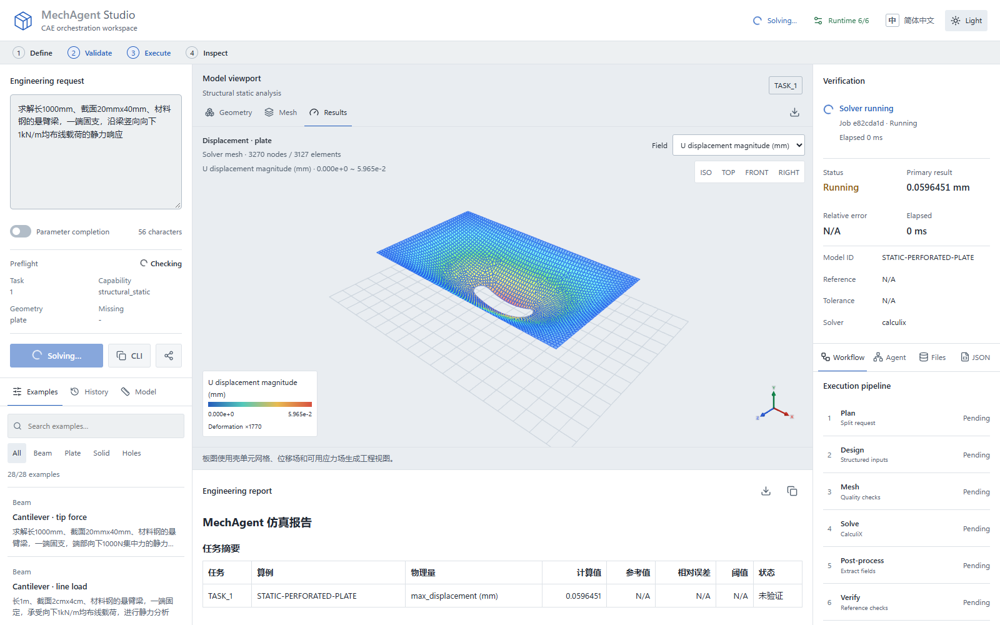

# Studio 使用指南

Studio 是本地工程工作台，用于提交请求、检查网格与结果、追踪 Agent 阶段和导出报告。界面状态来自 Python 编排与公开摘要。



## 启动与请求

激活项目虚拟环境后执行：

```powershell
python -m mechagent.cli studio --open-browser
python -m mechagent.cli demo
python -m mechagent.cli demo --example SC-25
```

默认监听 `127.0.0.1:8765`。`demo` 使用示例库中的 `SC-27`，提交长圆槽孔薄板请求；启用 LLM 使用 `--llm-agents`，运行前配置检查见[本地开发配置](local_setup.md)。

在左侧输入结构尺寸、材料、边界、载荷与方向。预检列出能力、几何与缺项；缺项并不因点击运行而自动消失。参数补全开关只控制 LLM 参与方式，所有结构化参数仍须通过执行门禁。

## 界面布局

顶栏提供环境诊断、语言和主题。紧凑进度条展示输入、预检、执行与结果。左栏包含请求、案例、历史与模型摘要；中间显示视口和报告；右栏显示验收以及流程、Agent、产物、JSON 标签。小屏按区域纵向排列。

中英文切换只调整操作文案、控件名称和已知摘要标签。请求、报告、工具返回的诊断与工程标识保留原文。主题默认深色，可切换浅色或跟随系统，语言和主题分别在浏览器本地保存。

## 视口与证据

- 几何模式显示参数外形、尺寸、约束和载荷；网格模式显示节点与单元拓扑；结果模式显示变形和可用场量。
- 结果模式要求网格文件和求解场量可读取；缺少任一项时显示不可用状态。
- 场量菜单提供 `U`、`Ux`、`Uy`、`Uz`；有应力数据时提供 `S Mises` 与应力分量。图例随数值范围与单位同步，变形倍率是显示倍率。
- 视角按钮提供等轴、俯视、前视与右视；鼠标交互支持旋转、缩放和平移。右下角 XYZ 视图跟随相机。
- 执行成功、参考校核通过和未验证是不同状态。检查器展示参考值、相对误差、阈值与求解器；无参考的工程场景保留未验证。
- 浏览器历史保存摘要和报告，不保存完整场景。服务器作业记录可恢复持久化完整结果，重试会创建关联原作业的新任务。

## 作业与恢复

提交后，工作台展示排队、启动、运行和取消中的状态。取消按钮向服务器登记取消请求，服务器终止已核验身份的执行进程后确认终态。取消不撤销已写入的文件；部分输入、输出和错误证据保留在作业目录。

浏览器保存当前作业标识和提交幂等键，刷新后接续轮询。连接失败时保留任务，提供重新连接和停止跟踪；停止跟踪不停止服务器计算。浏览器无法写入本地存储时显示提示，可通过历史标签中的服务器作业记录重新打开。服务器记录展示最近 10 项，可查看完整结果、显式重试与校验证据；本地历史清空不删除数据库或工程文件。

服务重启后继续查询已有作业。独立 worker 在 API 正常停止后继续执行；进程失联、心跳超时或无法确认身份时保留中断状态，不自动重新求解。worker 已退出且仍由当前调度器持有进程句柄时，作业响应还包含退出码；服务重启后接管的历史 worker 没有该句柄时退出码为空。重试使用当前配置，生成新的标识、目录和关联记录。数据库、运行目录和配置路径须保持可访问。

## 导出与复现

报告可复制或下载为 Markdown，摘要可导出 JSON，当前视图可导出 PNG 或 SVG。CLI 命令按当前请求、参数补全和后端 Python 路径生成；工作台链接恢复请求、LLM 开关和视图模式，不包含完整求解结果或私密配置。链接包含请求内容，分享前由使用者确认工程数据范围。

## 后端 API

Studio 后端位于 `packages/mechagent/src/mechagent/ui/server.py`。

稳定客户端使用 `/api/v1` 前缀。旧 `/api` 路径在兼容期内继续可用，并在响应中返回
`Deprecation: true`、`Sunset: 2027-06-30` 和 successor link；新集成不得依赖旧路径。

| 接口 | 输入与输出职责 |
| --- | --- |
| `GET /api/v1/health` | 服务、配置与静态资源状态 |
| `GET /api/v1/diagnostics` | 脱敏环境检查；`llm=true` 触发远端连接检查 |
| `GET /api/v1/capabilities` | 已注册能力与工具绑定 |
| `GET /api/v1/examples` | 自然语言案例目录 |
| `POST /api/v1/inspect` | 请求与 `use_llm_agents`；任务、缺项和可执行状态 |
| `POST /api/v1/jobs` | 创建请求作业，返回作业标识；跨组织管理员必须在请求中指定 `organization` |
| `GET /api/v1/jobs/{job_id}` | 作业状态、事件与终态结果 |
| `GET /api/v1/jobs` | 持久化列表，`limit` 为 1–100、默认 50；使用响应中的 `pagination.next_cursor` 请求下一页；`offset` 为兼容旧客户端保留，不能与 `cursor` 同时使用；不携带完整结果；跨组织管理员可用 `organization` 过滤 |
| `GET /api/v1/audit` | admin 读取当前组织和项目的主体操作审计事件，`limit` 为 1–1000；使用响应中的 `pagination.next_cursor` 请求下一页 |
| `GET /api/v1/metrics` | 受组织和项目权限约束的脱敏作业、结果、证据和 worker 资源指标；admin 不带 `project_id` 时读取相应组织范围 |
| `GET /api/v1/identities` | admin 读取当前组织的主体摘要；跨组织管理员读取全部组织；不返回 API key |
| `POST /api/v1/identities` | admin 创建主体并返回一次性明文 API key；数据库只保存 SHA-256 摘要 |
| `PATCH /api/v1/identities/{subject}` | admin 更新组织范围、角色、项目范围、启用状态和过期时间 |
| `POST /api/v1/identities/{subject}/rotate` | admin 轮换 key 并返回一次性明文 API key |
| `DELETE /api/v1/identities/{subject}` | admin 停用主体并立即拒绝其 key |
| `GET /api/identities`、`POST /api/identities` | 兼容路径；语义与对应 `/api/v1/identities` 相同并返回弃用响应头 |
| `PATCH /api/identities/{subject}`、`POST /api/identities/{subject}/rotate`、`DELETE /api/identities/{subject}` | 兼容路径；语义与对应 `/api/v1` 路径相同并返回弃用响应头 |
| `POST /api/v1/jobs/{job_id}/cancel` | 登记取消；终态请求保持终态 |
| `POST /api/v1/jobs/{job_id}/retry` | 仅允许终态作业，返回新作业及 `parent_job_id` |
| `GET /api/v1/jobs/{job_id}/evidence` | 终态作业的清单与文件完整性校验 |
| `GET /api/v1/jobs/{job_id}/artifacts` | 终态作业对象索引，返回安全相对路径、大小、媒体类型和 SHA-256 |
| `GET /api/v1/jobs/{job_id}/artifacts/{artifact_path:path}` | 按作业权限读取对象；服务端在返回前校验并恢复内容 |
| `POST /api/v1/run` | 使用同一持久队列等待终态，返回报告、摘要与可视化；长任务建议使用异步作业接口 |

主体的 `expires_at` 使用带时区的 ISO 8601 时间。创建主体或明确设置过期时间时，该时间必须晚于服务当前时间；认证查询会拒绝已过期主体。更新主体时省略 `expires_at` 保留原值，显式传入 `null` 表示永不过期。

旧兼容入口包含同一路径的 `/api/metrics`，其响应头声明弃用周期。

### Python HTTP 客户端

`mechagent.StudioClient` 是 `/api/v1` 的同步客户端。构造时传入带版本前缀的绝对 `base_url`；
客户端拒绝带 query 或 fragment 的地址，并将 `api_key` 作为 `Authorization: Bearer` 请求头发送。
`health()`、`diagnostics()`、`capabilities()`、`examples()`、`inspect()`、`create_job()`、`run()`、
作业查询与操作、`metrics()`、对象索引与主体目录方法分别对应上表接口，返回值保留服务端 JSON 结构。
`download_artifact()` 返回经过服务端摘要校验的对象字节；对象路径只能是作业清单中的安全相对路径。

`create_job()`、`run()` 和 `retry_job()` 在未传入 `idempotency_key` 时生成随机键；传入的键按原值发送，
长度必须为 1–128 个非空白字符。客户端不自动重试，调用方需要在重试可安全执行时复用幂等键。
`list_jobs()` 支持 `cursor` 或兼容的 `offset`，两者不能同时使用；`list_audit()` 使用稳定游标。
后续页面通过响应中的 `pagination.next_cursor` 读取，游标为空表示没有后续页面。

HTTP 非 2xx 响应抛出 `StudioClientError`，字段 `status_code`、`code`、`detail` 和 `request_url`
分别表示 HTTP 状态、机器可读错误码、服务端诊断和请求地址。无法建立 HTTP 请求时，错误码为
`transport_error`、状态码为 `0`，服务端没有可用的 `request_url`。客户端不打印 API key，也不会把
服务端错误转换为成功结果。

```python
from mechagent import StudioClient, StudioClientError

try:
    with StudioClient("http://127.0.0.1:8765/api/v1", api_key="<api-key>") as studio:
        page = studio.list_jobs(project_id="default", limit=50)
        while page["pagination"]["next_cursor"]:
            page = studio.list_jobs(cursor=page["pagination"]["next_cursor"])
except StudioClientError as exc:
    print(exc.code, exc.status_code, exc.detail)
```

作业、诊断、报告和主体目录类 `/api/v1` 接口保留同一路径结构的 `/api` 兼容入口。请求和响应字段、错误码、
幂等语义与队列限制一致。启用 `studio.auth_required` 后，API 使用 `Authorization: Bearer <key>`，主体角色决定读取、提交、取消和重试权限，组织和项目范围共同决定可见作业；配置主体和受管理主体的密钥均只以 SHA-256 摘要保存。受管理主体只属于一个组织，管理员只能管理本组织主体；组织为 `*` 的管理员可跨组织管理。当前实现使用单个 SQLite 数据库；外部身份提供商、集中审计和分布式配额需要部署扩展。
兼容入口包括 `GET /api/health`、`GET /api/diagnostics`、`GET /api/capabilities`、
`GET /api/examples`、`POST /api/inspect`、`POST /api/jobs`、`GET /api/jobs/{job_id}`、
`GET /api/jobs`、`GET /api/audit`、`POST /api/jobs/{job_id}/cancel`、`POST /api/jobs/{job_id}/retry`、
`GET /api/jobs/{job_id}/evidence`、`GET /api/jobs/{job_id}/artifacts`、
`GET /api/jobs/{job_id}/artifacts/{artifact_path:path}` 和 `POST /api/run`。

`POST /api/v1/jobs`、`POST /api/v1/run` 和重试接口接受 `Idempotency-Key` 请求头（1–128 字符）。同一键、请求、配置路径及重试来源返回同一作业，键冲突返回 409；键在数据库保留期间有效。队列满返回 429，调度未启动或已停止返回 503，作业不存在返回 404。事件最多保留最近 256 项；完整结果仅通过单作业查询取得，结果文件缺失或哈希不符返回 409。旧 `/api` 入口遵循相同语义。

作业和审计列表使用稳定游标分页。作业游标绑定最后一条记录的 `created_at` 与 `job_id`，审计游标绑定递减的 `sequence`；游标只在相同项目、组织和主体可见范围内继续有效。后续写入记录不会改变已经读取页面的边界，服务端每页响应包含 `pagination.limit`、`pagination.has_more` 和 `pagination.next_cursor`。游标格式错误、与筛选条件冲突或同时提交 `offset` 与 `cursor` 返回 400。旧客户端可以继续使用作业列表的 `offset`，但新集成应使用游标。

Studio 使用 SQLite WAL 本机持久队列，支持配置主体、受管理主体、角色、组织和项目范围；分布式高可用和远程调度需要部署扩展。默认仅监听回环地址；外网或多人部署需要独立的身份提供商、网络边界、集中审计和配额服务。能力限制见[能力说明](capabilities.md)，视觉与交互规则见[设计系统](design_system.md)。
